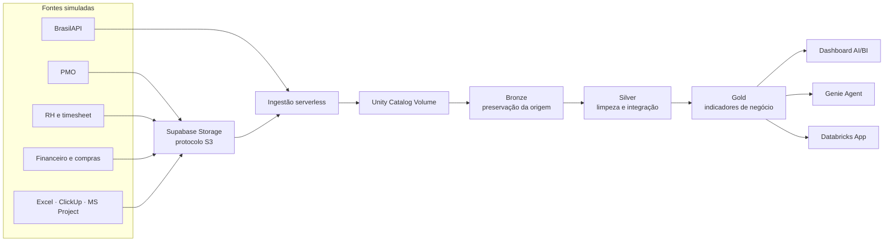
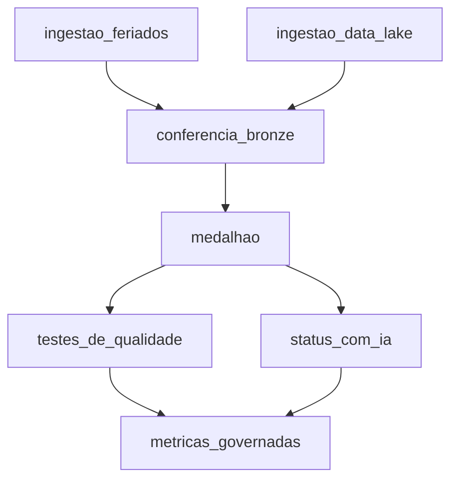

# Projeto Farol · Torre de Controle de Projetos

> Uma plataforma Lakehouse construída no Databricks para transformar dados dispersos de projetos em decisões sobre prazo, custo, risco e capacidade das equipes.


## Sobre o projeto

O **Projeto Farol** simula a torre de controle da **Vértice Tecnologia**, uma
empresa fictícia cujas informações de projetos estão distribuídas entre PMO,
RH, timesheet, financeiro, compras e diferentes ferramentas de gestão.

A solução centraliza essas fontes em uma arquitetura medalhão, aplica contratos
de qualidade, estrutura textos de status com inteligência artificial e entrega
informações por três experiências: dashboard executivo, agente conversacional e
aplicativo analítico.

> **Nota:** todos os dados são sintéticos, gerados deterministicamente com seed
> `42` para fins educacionais. Eles não representam pessoas, projetos ou
> resultados de uma empresa real. A data de referência da simulação é
> **16/10/2026**.

### Projeto em números

| Indicador | Volume |
|---|---:|
| Projetos | 60 |
| Colaboradores | 523 |
| Status semanais | 3.911 |
| Apontamentos de horas | 30.883 |
| Tabelas Silver integradas | 7 |
| Produtos analíticos | 3 |
| Benchmark do Genie | 20/20 |

## Problemas de negócio respondidos

- Quais projetos estão atrasados ou acima do orçamento?
- Qual é o estouro previsto e a margem projetada da carteira?
- O farol informado pelo gerente é coerente com os indicadores?
- Onde há capacidade ociosa que poderia apoiar projetos críticos?
- Quais bloqueios mais afetam o portfólio?
- Quais fornecedores estão atrasando entregas?
- O que pode dar errado no próximo mês e onde agir primeiro?

## Arquitetura



Todos os objetos de dados são governados pelo Unity Catalog no catálogo
`lakehouse_vertice`, organizado nos schemas `bronze`, `silver` e `gold`.

## Fontes de dados simuladas

| Área ou sistema | Formato | Informação representada |
|---|---|---|
| PMO | CSV | Projetos, contratos, orçamento e status semanais |
| RH | CSV | Colaboradores, papéis, senioridade e custo por hora |
| Timesheet | CSV | Horas disponíveis e apontadas por semana |
| Financeiro | CSV | Custos reais dos projetos |
| Compras | CSV | Entregas e desempenho de fornecedores |
| Excel | XLSX | Cronogramas mantidos em planilhas |
| ClickUp | JSON | Listas, tarefas e campos personalizados |
| Microsoft Project | XML | Cronogramas exportados do MS Project |
| BrasilAPI | API HTTP | Feriados nacionais de 2026 |

O Supabase Storage funciona como a área de entrada compatível com S3. Os
arquivos são copiados para um Volume do Unity Catalog antes de serem convertidos
em tabelas.

## Arquitetura medalhão

### Bronze — rastreabilidade

Preserva os dados próximos de sua forma original. Uma conferência automática
valida as contagens esperadas das nove fontes principais antes de permitir que o
processamento avance.

### Silver — padronização e integração

Sete tabelas tratam datas, valores, percentuais, duplicidades, nomenclaturas e
contratos de qualidade. Cronogramas de Excel, ClickUp e MS Project são
convertidos para um único modelo de tarefas.

### Gold — indicadores de negócio

| Objeto | Finalidade |
|---|---|
| `fato_projeto_semana` | Evolução semanal de PV, EV, AC, SPI, CPI, EAC e horas |
| `projeto_situacao_atual` | Fotografia executiva dos 60 projetos |
| `utilizacao_pessoa_semana` | Utilização, ociosidade e custo por pessoa, projeto e semana |
| `status_estruturado` | Causas e impactos extraídos dos textos dos gerentes |
| `mv_projetos` | Métricas governadas para dashboard, SQL e Genie |

Indicadores principais:

- `SPI = EV / PV`: desempenho de prazo;
- `CPI = EV / AC`: desempenho de custo;
- `EAC = orçamento / CPI`: custo estimado ao término;
- `margem projetada = (contrato − EAC) / contrato`;
- **falso verde**: farol informado como verde com SPI abaixo de `0,90`.

SPI e CPI da carteira são calculados pela razão entre somas, evitando a média
incorreta de índices de projetos com tamanhos diferentes.

## Orquestração

O job `vertice_farol` usa compute serverless `STANDARD`, limita a concorrência
a uma execução e mantém o agendamento pausado no ambiente de desenvolvimento.



O pipeline `vertice_medalhao` é declarativo, serverless, utiliza Photon e
publica as camadas Silver e Gold.

## Inteligência, qualidade e governança

- **AI Functions:** `ai_classify` e `ai_extract` transformam textos livres dos
  gerentes em causa do bloqueio, responsável e impacto em dias.
- **Processamento incremental:** um `LEFT ANTI JOIN` seguido de `MERGE` impede
  novas chamadas de IA para status já classificados.
- **Metric View:** centraliza as definições oficiais de carteira, SPI, CPI, EAC,
  margem, riscos, críticos e falsos verdes.
- **Qualidade:** dez testes verificam cobertura, unicidade, reconciliação
  financeira e consistência entre Bronze, Silver e Gold.
- **Governança:** Unity Catalog controla objetos e permissões; o App usa OAuth
  para consultar o Genie respeitando o usuário autenticado.
- **Segredos:** credenciais ficam em arquivo local ignorado pelo Git e são
  entregues ao job por referências de secret scope.
- **Infraestrutura como código:** jobs, pipeline, dashboard e Genie são
  versionados e implantados com Declarative Automation Bundles.

## Produtos finais

### Dashboard AI/BI — Projeto Farol · Portfólio

Três páginas executivas apresentam portfólio, capacidade das pessoas e
fornecedores, com filtros, KPIs, evolução semanal, riscos, bloqueios e atrasos.

[Abrir dashboard publicado](https://dbc-d9922c6a-e0c3.cloud.databricks.com/dashboardsv3/01f1cff17f241a16bad0b83c33ef1e8f/published?w=1487041240090169)

### Genie Agent — Farol · Diretoria

Agente de dados em português, alimentado pelas tabelas Gold, fornecedores
Silver e pela Metric View governada. O conjunto de referência possui 20
perguntas executivas e atingiu benchmark `20/20`.

[Abrir Farol · Diretoria](https://dbc-d9922c6a-e0c3.cloud.databricks.com/genie/rooms/01f1cff8027f18b189265b533b804bdd?w=1487041240090169)

### Databricks App — Projeto Farol

Aplicação React e TypeScript construída com AppKit, contendo:

- **Projetos em risco:** KPIs e fila executiva de atuação;
- **Simulador:** impacto operacional e financeiro de uma realocação;
- **Perguntar:** conversa integrada com o Genie Agent.

[Abrir Projeto Farol](https://minha-torre-1487041240090169.aws.databricksapps.com)

> Os três links acima exigem autenticação e permissões no workspace Databricks.

## Tecnologias

| Categoria | Tecnologias |
|---|---|
| Plataforma | Databricks, Unity Catalog, SQL Warehouse serverless |
| Engenharia de dados | Lakeflow Jobs, Spark Declarative Pipelines, Photon |
| Linguagens | SQL, Python, TypeScript |
| Inteligência artificial | AI Functions, Genie Agent |
| Visualização | AI/BI Dashboards, React, AppKit |
| Infraestrutura | Declarative Automation Bundles, Databricks CLI |
| Armazenamento de entrada | Supabase Storage com protocolo S3 |
| Qualidade e versionamento | Expectations, testes SQL, Git e GitHub |

## Estrutura do repositório

```text
projeto_databricks/
├── config/          # Exemplo versionável da configuração local
├── llm/             # Prompts operacionais adaptados para Codex
├── minha-torre/     # Databricks App independente em React/TypeScript
├── resources/       # Job, pipeline, dashboard e Genie declarados como código
├── scripts/         # Geradores, publicação, execução SQL e sincronização
├── src/
│   ├── ingestao/    # Supabase/S3 e BrasilAPI
│   ├── conferencia/ # Contrato de contagens da Bronze
│   ├── silver/      # Limpeza e integração
│   ├── gold/        # Indicadores executivos
│   ├── ia/          # Estruturação incremental de status
│   ├── metricas/    # Metric View governada
│   ├── setup/        # Bootstrap do catálogo, schemas e volume
│   └── testes/      # Testes de qualidade
├── tests/           # Benchmark do Genie e testes auxiliares
└── databricks.yml   # Entrada do bundle principal
```

Detalhes específicos do aplicativo estão em
[`minha-torre/README.md`](minha-torre/README.md).

## Como executar

### Pré-requisitos

- Databricks CLI autenticado no perfil `DEFAULT`;
- acesso a um SQL Warehouse serverless;
- permissões no Unity Catalog;
- bucket compatível com S3 contendo as fontes esperadas;
- Python e Node.js/npm para scripts e aplicativo.

### 1. Configurar variáveis locais

O repositório contém apenas um exemplo sem credenciais. No PowerShell:

```powershell
New-Item -ItemType Directory -Force .databricks/bundle/dev
Copy-Item config/variable-overrides.example.json .databricks/bundle/dev/variable-overrides.json
```

Preencha o arquivo local e sincronize as chaves com o secret scope:

```powershell
python scripts/sync_secrets.py --profile DEFAULT
```

Nunca versione `.databricks/bundle/dev/variable-overrides.json`.

### 2. Criar a infraestrutura de dados

```powershell
python scripts/run_sql.py src/setup/00-bootstrap.sql --profile DEFAULT --warehouse a25e41e310648f85
```

### 3. Validar, implantar e executar

```powershell
databricks bundle validate --strict --profile DEFAULT
databricks bundle deploy --profile DEFAULT
databricks bundle run vertice_farol --profile DEFAULT
```

Para recalcular apenas o medalhão e as tarefas posteriores, sem recarregar a
Bronze:

```powershell
databricks bundle run vertice_farol --only medalhao+ --profile DEFAULT
```

### 4. Validar o aplicativo

```powershell
Set-Location minha-torre
npm install
npm run typegen
npm run typecheck
npm run lint
npm test
databricks apps validate --profile DEFAULT
```

## Aprendizados

Este projeto reúne engenharia de dados, modelagem analítica, qualidade,
governança, inteligência artificial e desenvolvimento de produto. O principal
aprendizado foi tratar o Lakehouse não apenas como armazenamento, mas como uma
plataforma completa: da ingestão de arquivos heterogêneos até uma experiência
executiva confiável e conversacional.

---

Desenvolvido por [Tony Miguel Silva](https://github.com/tonymiguelsilva).
